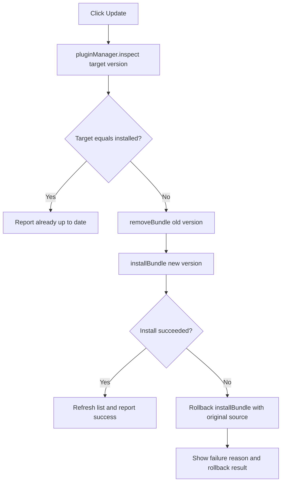

<div align="center">

# DSH Plugin Manager

**Review, update and remove DeepSeek Harness plugins from the sidebar — without leaving the conversation.**

[](https://github.com/XWQ2018/dsh-plugin-manager/releases)
[](./LICENSE)
[](https://github.com/deepseek-ai/deepseek-harness)
[](https://github.com/XWQ2018/dsh-plugin-manager/stargazers)

[Features](#features) · [Requirements](#requirements) · [Installation](#installation) · [Usage](#usage) · [How it works](#how-it-works) · [Development](#development) · [FAQ](#faq) · [License](#license)

</div>

---

## Overview

DSH Plugin Manager (`@xiaoweiq66/dsh-plugin-manager`) is a plugin for [DeepSeek Harness](https://github.com/deepseek-ai/deepseek-harness). It adds a **Plugin Manager** icon to the sidebar panel list. Clicking it opens a centered window that lists every plugin installed in the current profile — name, version, package name and description — and offers **per-plugin update**, **update all**, and **remove**.

No more switching to a terminal to run package commands or hand-editing the profile dependency file: open the window to see which plugins have new versions, and failed updates roll back to the previous source automatically.

## Features

| Capability | Description |
| --- | --- |
| Sidebar entry | Registers a **Plugin Manager** icon in the sidebar panel list; clicking it opens the centered manager window |
| Plugin list | Shows name (localized title when the plugin provides one), version, package name and a two-line description; updatable plugins first, built-in bundles last |
| Update check | Queries the configured plugin market indexes in the background and compares versions; shows **New version vX · What's new ›** when an update exists |
| Single update | Calls `inspect()` to confirm the target version, reports "already up to date" when it matches, otherwise removes the old version and installs the new one, rolling back to the original source on failure |
| Update all | Updates every updatable plugin in sequence and summarizes the counts of updated / up-to-date / failed plugins |
| Safe removal | Inline confirmation row before anything is removed |
| Built-in protection | Bundles shipped with DSH are tagged **Built-in**; update and remove buttons are disabled with an explanatory tooltip |
| Bilingual UI | Follows the active DSH language (Chinese / English) |
| Theme aware | Uses DSH design tokens throughout, so light and dark themes both work |
| Keyboard accessible | `Esc` closes the dialog, `Tab` cycles focus inside it, every button has a readable label |

## Requirements

- **DeepSeek Harness 0.2.1-rc.3 up to, but not including, 0.3.0** (verified on `0.2.1-rc.3`).
- A **web profile** or the desktop app: the client half declares `dsh.client.platform: web`.
- The built-in `pluginManager` service, which ships with DSH — nothing extra to install.
- **Update checks are optional**: they need a plugin market index configured in DSH (`pluginMarket`). Without one the window still works; it just never reports new versions and keeps the update buttons disabled.

## Installation

The plugin can be installed from three sources — **npm (recommended)**, the GitHub repository, or a local directory — or by asking DSH to install it through the plugin management tool. The examples use the `web` profile — replace it with the profile you actually boot (the desktop app usually uses `web`, the terminal app usually `tui`).

### Option 1: From npm (recommended)

```bash
dsh plugin --profile web add @xiaoweiq66/dsh-plugin-manager
```

This only talks to the npm registry, never to git, so it is not affected by networks where the browser can open GitHub but git cannot. If the registry itself is restricted, configure a mirror for pnpm first (for example `registry=https://registry.npmmirror.com`).

### Option 2: From GitHub

```bash
dsh plugin --profile web add github:XWQ2018/dsh-plugin-manager
```

Requires git to reach GitHub over HTTPS on that machine; if only SSH works, see the FAQ.

### Option 3: From a local directory

```bash
dsh plugin --profile web add /absolute/path/to/dsh-plugin-manager
```

The path must be **absolute**; the plugin manager rejects relative paths. On Windows it looks like `D:\plugins\dsh-plugin-manager`.

### Option 4: Ask DSH to install it

In a DSH session, have the model call the `plugin_manager` tool:

- `action`: `install_bundle`
- `target`: `@xiaoweiq66/dsh-plugin-manager`, `github:XWQ2018/dsh-plugin-manager`, or the absolute path of a local directory

This requires `danger-full-access` permission or a per-call approval. It uses the same management service as the Web UI; the CLI option forwards to pnpm instead, with the same end result.

> **What success looks like**: after restarting DSH, a **Plugin Manager** icon appears in the sidebar panel list, near the skill center.

## Usage

### Open the panel

Click the **Plugin Manager** icon in the sidebar. The window opens above the current conversation and switches the main area back to the conversation; closing the window restores the previous view.

### Reading the list

Each plugin occupies one row:

- **Avatar**: first character of the name on a stable gradient, so the same package always gets the same color.
- **Name and version**: the localized title when available, with `vX.Y.Z` on the right.
- **Tag**: `Installed` for profile dependencies, `Built-in` for bundles shipped with DSH.
- **Package name**: monospaced, for verification.
- **Description**: at most two lines, truncated automatically.

Ordering: updatable profile plugins first, built-in bundles last, alphabetical by package name within each group. The plugin manager itself never appears in the list.

### Checking for updates

On open, the plugin queries the configured market indexes in the background and compares versions semantically. Reopening within 60 seconds does not query again.

- Update available: **New version vX · What's new ›** appears under the description.
- Click **What's new ›**: expands the current → latest version comparison, the latest description, and an **Update now** button.
- Not listed in an index, no index configured, or the query failed: nothing is shown and the update button stays disabled.

### Updating one plugin

Click **Update** on a row. The flow is:

1. `pluginManager.inspect()` checks the target version; if it matches the installed one, the UI reports "already up to date" and stops.
2. `removeBundle()` removes the old version, then `installBundle()` installs the new one.
3. If installation fails, the original source is installed again as a rollback, and the error message says whether it was restored.

The list refreshes automatically after the operation.

### Update all

The **Update all** button sits left of the refresh button in the dialog header. It runs the same check-and-update flow for every updatable plugin and then summarizes the result in the notice bar:

```text
Update finished: 3 / 5 · up to date 1 · failed 1
```

The button is enabled only when at least one update is available; while it runs, every action button is disabled to avoid concurrent changes.

### Removing a plugin

Click **Remove**. A confirmation row appears under the plugin; confirming runs `removeBundle()`. Built-in bundles and bundles DSH marks as non-removable have the button disabled.

### Built-in plugins

Bundles shipped with DSH carry a **Built-in** tag:

- Update is disabled with the tooltip "Provided by DSH itself and updated with it".
- Remove is disabled with the tooltip "Provided by DSH itself and cannot be removed".
- They upgrade together with DSH.

### Keyboard and accessibility

| Action | How |
| --- | --- |
| Open the manager | Click the sidebar icon, or focus it and press `Enter` / `Space` |
| Close the dialog | Close button, `Esc`, or click the backdrop outside the dialog |
| Move focus inside | `Tab` / `Shift+Tab`; focus wraps inside the dialog |

### Notices and errors

- Success: a green notice such as "Updated xxx".
- Restart needed: "Saved; restart DSH for it to take effect".
- Failure: a red error bar with the reason and a **Retry** button.

## How it works

The plugin has two halves:

- **Host half (`index.js`)**: registers no services. All data and mutations go through DSH's existing `pluginManager` Host service via its Remote entry points (`listBundles` / `inspect` / `installBundle` / `removeBundle`), so there is no second implementation of plugin management.
- **Client half (`client.js`)**: registers the UI slots and renders the entry icon and the manager window.

### Registered slots

| Slot | Purpose |
| --- | --- |
| `sidebar.panellist` | Sidebar panel entry icon (`order: 40`) |
| `main` | Switches the main area back to the conversation when the dialog opens |
| `shell.overlay` | The centered manager window |

### Update flow



### Update-check details

- Opening the dialog calls `listBundles()` for the current profile and filters out the plugin manager itself.
- In the background it reads every configured index URL from `pluginMarket.listIndexes()` and runs `search()` for each updatable plugin, first with the short name and then with the full name.
- It takes `defaultVersion`, falling back to `versions[0].version`, and compares versions segment by segment.
- Results are cached for 60 seconds (`lastUpdateCheck`) to avoid repeated requests.
- Any failure only marks that plugin as "unknown": no update hint is shown and the list keeps working.

### How the update source is resolved

The install spec used for an update is resolved in this order:

1. `bundle.installTarget.spec` (the source recorded by the plugin manager).
2. `bundle.source` with any `file:` / `link:` prefix stripped.
3. Fallback: `<package-name>@latest`.

Rollback reuses the same source; when the source is a local path, rollback reinstalls from that path.

### Project layout

```text
dsh-plugin-manager/
├── index.js            # Host half: empty implementation, reuses pluginManager
├── client.js           # Client half: entry icon, manager dialog, all UI logic
├── cordis.patch.yml    # Patch row that inserts this bundle into the Loader
├── locale/
│   ├── zh.json         # Chinese title and description shown in the plugin list
│   └── en.json         # English title and description
├── icon.svg            # Plugin icon
└── package.json        # Package metadata + dsh field (bundle / client config)
```

The DSH-specific part of `package.json`:

```json
{
  "dsh": {
    "bundle": { "patch": "./cordis.patch.yml" },
    "client": {
      "platform": "web",
      "immediately": true,
      "inject": [
        "@deepseek-ai/dsh-client-ui-sidebar",
        "@deepseek-ai/dsh-client-ui-layout"
      ]
    }
  }
}
```

### DSH capabilities used

- **Cordis slots**: `sidebar.panellist`, `main`, `shell.overlay`.
- **Remote services**: `remote.pluginManager` (required) and `remote.pluginMarket` (optional, for update checks).
- **Internationalization**: `locale.register()` under the `dsh-plugin-manager` namespace.
- **Design tokens**: the `--dsw-alias-*` CSS variables, so light and dark themes both work.

## Compatibility and boundaries

- **Current profile only**: it manages the plugins of the profile DSH is currently running; switching profiles shows a different set.
- **Built-in bundles are read-only**: no update or remove; they ship with DSH.
- **It does not manage itself**: the plugin manager never lists itself and cannot remove itself from the UI. Remove it with the CLI (next section).
- **Failures roll back**: a failed update reinstalls the original source and reports whether the rollback succeeded.
- **Restarts may be required**: some changes return `restart-required`, and the dialog says "Saved; restart DSH for it to take effect".
- **Approvals may be requested**: install and remove change the profile dependencies and configuration rows, so DSH may ask for approval — that is DSH's safety design.
- **Update checks need the network**: an unreachable market index only hides the "new version" hint; manual updates still work.

## Uninstall

The manager never lists itself, so remove it with the CLI:

```bash
dsh plugin --profile web remove @xiaoweiq66/dsh-plugin-manager
```

Restart DSH afterwards and the sidebar icon disappears. This removes the plugin dependency and its configuration row only; your session data is untouched.

## Development

### Local development

```bash
git clone https://github.com/XWQ2018/dsh-plugin-manager.git
dsh plugin --profile web add /absolute/path/to/dsh-plugin-manager
```

- With `patchReload: live` in the profile, edits to `client.js` hot-reload in the UI.
- Changes to the Host half, `cordis.patch.yml`, or the installed dependency set are best applied by restarting DSH.

### Code conventions

- Keep the Host half empty: all data goes through the existing `pluginManager` service; do not build a parallel implementation.
- Always use DSH design tokens in new UI; hard-coded colors break the themes.
- New strings must be added in both places: the inline dictionaries in `client.js` (`zh` / `en`) and `locale/*.json`.
- Keep the dialog keyboard accessible: use native `button` elements for clickable items and add `aria-label` where needed.

### Releasing

1. Bump `version` in `package.json`.
2. Update the README wherever behavior or versions are described.
3. Commit, tag, and create a GitHub Release.
4. To publish on npm: the package is the scoped name `@xiaoweiq66/dsh-plugin-manager`, `private` is removed, and the license is MIT. `publishConfig.access` is already set to `public`, so running `npm publish` in the package directory is enough (passing `--access public` is equivalent).

## FAQ

**Install fails with `pnpm resolves this specifier over HTTPS...`?**
That message comes from pnpm's git resolver, not from DSH or this plugin: pnpm always resolves `github:` specs over HTTPS and records a portable URL. If git on that machine can reach github.com only over SSH, rewrite the transport locally as the message suggests:

```bash
git config --global url."git@github.com:".insteadOf "https://github.com/"
dsh plugin --profile web add github:XWQ2018/dsh-plugin-manager
```

This only changes local git behavior; pnpm still records the HTTPS URL, so other machines are unaffected. Undo it with `git config --global --unset url."git@github.com:".insteadOf`. Without an SSH key, or when HTTPS is blocked by a proxy, use the npm install option above instead. Also make sure the repository is **public** — nobody can install from a private repository without access.

**No Plugin Manager icon in the sidebar?**
Make sure the plugin is installed into the profile you actually boot, then restart DSH. Terminal and desktop profiles are separate — it is easy to install into the wrong one.

**The update button is always disabled?**
Three usual causes: the installed version is the latest; no plugin market index is configured (so updates cannot be detected); or the plugin is a built-in bundle.

**"The plugin management service is unavailable"?**
The `pluginManager` service failed to load, usually a DSH startup or profile configuration problem. Restart DSH and check the startup log.

**An update failed — what now?**
The red notice bar explains why; click **Retry**. If the recorded source is gone (for example a deleted local directory), install the correct source again with the CLI.

**Where can I read the release notes for a new version?**
When an update is available, click **What's new ›** to expand the version comparison and the latest description.

**Why can't I see the plugin manager in its own list?**
By design, so the management entry cannot uninstall itself from the UI. Use the CLI to remove it.

**The icon is still there after uninstalling?**
Restart DSH. Slots are released when the process exits.

## Contributing

Issues and pull requests are welcome:

- For bugs, include the DSH version, operating system, reproduction steps and screenshots.
- Before opening a PR, walk through install, update and remove in a local profile.
- For UI changes, attach screenshots in both light and dark themes.

## License

Released under the [MIT License](./LICENSE), Copyright © 2026 XWQ2018.

## Acknowledgements

- [DeepSeek Harness](https://github.com/deepseek-ai/deepseek-harness): the plugin system, Cordis slots, Remote services and design tokens.
- Everyone who filed issues and shared feedback.
