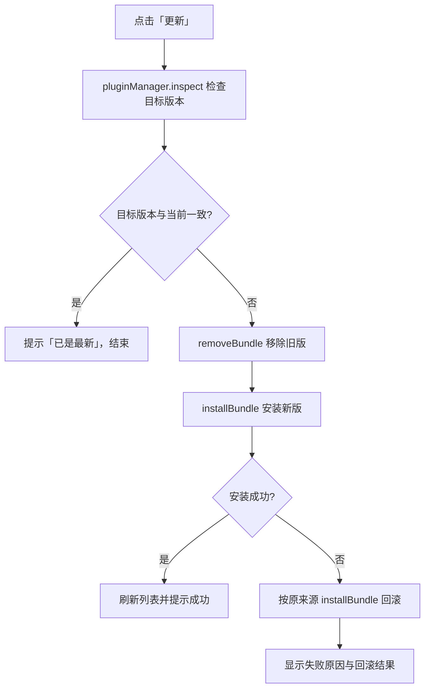

<div align="center">

# DSH 插件管理

**在 DeepSeek Harness 侧栏里查看、更新和卸载插件，不用离开会话。**

[](https://github.com/XWQ2018/dsh-plugin-manager/releases)
[](./LICENSE)
[](https://github.com/deepseek-ai/deepseek-harness)
[](https://github.com/XWQ2018/dsh-plugin-manager/stargazers)

[功能](#功能) · [环境要求](#环境要求) · [安装](#安装) · [使用指南](#使用指南) · [工作原理](#工作原理) · [开发](#开发) · [常见问题](#常见问题) · [许可证](#许可证)

</div>

---

## 简介

DSH 插件管理（`@xiaoweiq66/dsh-plugin-manager`）是 [DeepSeek Harness](https://github.com/deepseek-ai/deepseek-harness) 的一个插件：在侧栏面板图标区加一个「插件管理」图标，点开后是一个居中的管理窗口，在一个窗口里列出当前 profile 里已安装的插件——名称、版本、包名和简介，并直接提供**单个更新**、**全部更新**和**卸载**。

不用再切到终端敲包管理命令，也不用翻 profile 的依赖文件：打开窗口就能看到谁有新版本，失败时还会自动回滚到原版本。

## 功能

| 能力 | 说明 |
| --- | --- |
| 侧栏入口 | 在侧栏面板图标区注册「插件管理」图标，点击打开居中管理窗口 |
| 插件清单 | 展示名称（优先使用插件自带的本地化标题）、版本、包名和两行简介；可更新的插件排在前面，内置插件排在后面 |
| 版本检查 | 打开窗口后在后台查询已配置的插件市场索引，与本地版本比较；有新版本时显示「有新版本 vX · 更新内容 ›」 |
| 单个更新 | 先 `inspect()` 确认目标版本，已是最新则提示；否则先移除旧版再安装新版，安装失败自动用原来源回滚 |
| 全部更新 | 一次处理所有可更新插件，结束后汇总「已更新 / 已是最新 / 失败」的数量 |
| 安全卸载 | 行内二次确认，确认后才执行移除 |
| 内置保护 | 随 DSH 一起提供的内置 bundle 标记为「内置」，更新和卸载按钮禁用并说明原因 |
| 双语界面 | 跟随 DSH 当前语言自动切换中文 / English |
| 主题适配 | 全部使用 DSH 设计变量，跟随明暗主题，不写死颜色 |
| 键盘可达 | Esc 关闭窗口、Tab 在窗口内循环焦点、所有按钮带可读标签 |

## 环境要求

- **DeepSeek Harness 0.2.1-rc.3 及以上、0.3.0 以下**（当前在 `0.2.1-rc.3` 上验证）。
- 使用 **web profile** 或桌面版：插件的前端半边声明为 `dsh.client.platform: web`。
- 依赖 DSH 内置的 `pluginManager` 服务；该服务随 DSH 提供，无需额外安装。
- **版本检查为可选能力**：需要在 DSH 里配置插件市场索引（`pluginMarket`）。没有配置时窗口仍可正常使用，只是不提示新版本，更新按钮保持置灰。

## 安装

插件有三种安装来源：**npm 包（推荐）**、GitHub 仓库和本地目录；也可以在会话里让 DSH 调用插件管理工具安装。下面以 `web` profile 为例，请换成你实际启动 DSH 时用的 profile（桌面版通常是 `web`，终端版通常是 `tui`）。

### 方式一：从 npm 安装（推荐）

```bash
dsh plugin --profile web add @xiaoweiq66/dsh-plugin-manager
```

只访问 npm registry，不碰 git，也不受「浏览器能打开 GitHub、但 git 拉不动」这类网络问题影响。registry 访问受限时，先给 pnpm 配置镜像（例如 `registry=https://registry.npmmirror.com`）再安装。

### 方式二：从 GitHub 安装

```bash
dsh plugin --profile web add github:XWQ2018/dsh-plugin-manager
```

需要这台机器的 git 能通过 HTTPS 访问 GitHub；只能走 SSH 时，见「常见问题」里的处理方式。

### 方式三：从本地目录安装

```bash
dsh plugin --profile web add /absolute/path/to/dsh-plugin-manager
```

本地路径必须是**绝对路径**，插件管理器不接受相对路径；Windows 下形如 `D:\plugins\dsh-plugin-manager`。

### 方式四：在会话里让 DSH 安装

在 DSH 会话中让模型调用 `plugin_manager` 工具：

- `action`: `install_bundle`
- `target`: `@xiaoweiq66/dsh-plugin-manager`、`github:XWQ2018/dsh-plugin-manager`，或本地目录的绝对路径

该操作需要 `danger-full-access` 权限，或在调用时单独审批。它和 Web 界面使用的是同一套插件管理服务；命令行方式则转发给 pnpm，最终效果一致。

> **安装成功的样子**：重启 DSH 后，侧栏底部的面板图标区会出现「插件管理」图标，位置在技能中心附近。

## 使用指南

### 打开面板

点击侧栏的「插件管理」图标。窗口从当前会话上方弹出，并自动把主区域切回会话；关闭窗口即可回到原界面。

### 读懂列表

每个插件占一行：

- **头像**：名称首字符 + 固定渐变底色，同一个包永远同一种颜色，便于快速识别。
- **名称与版本**：名称优先取插件自带的本地化标题，右侧显示 `vX.Y.Z`。
- **标签**：`已安装` 表示来自当前 profile 的依赖，`内置` 表示随 DSH 提供。
- **包名**：等宽字体显示，便于核对。
- **简介**：最多两行，超出自动截断。

排序规则：可更新的 profile 插件在前，内置插件在后，同类按包名排序。插件管理自身不会出现在列表里。

### 检查更新

打开窗口后，插件会在后台查询已配置的插件市场索引，并把结果和本地版本做语义化比较。60 秒内重复打开不会重复查询。

- 有新版本：简介下方出现「有新版本 vX · 更新内容 ›」。
- 点击「更新内容 ›」：展开当前版本 → 最新版本、最新版描述，以及「立即更新」按钮。
- 索引未收录、没有配置索引或查询失败：不显示任何提示，更新按钮保持置灰。

### 更新单个插件

点击插件右侧的「更新」按钮，流程如下：

1. 用 `pluginManager.inspect()` 检查目标版本；版本与当前一致则提示「已是最新」并结束。
2. 先用 `removeBundle()` 移除旧版，再用 `installBundle()` 安装新版。
3. 安装失败时，用插件原来的来源执行一次 `installBundle()` 回滚，并在错误提示里说明是否恢复成功。

安装完成后列表会自动刷新。

### 全部更新

窗口顶部的「全部更新」按钮位于刷新按钮左侧。它会依次对所有可更新插件执行上面同一套检查与更新流程，结束后在顶部通知条汇总：

```text
更新完成：3 / 5 · 已是最新 1 · 失败 1
```

只有存在可更新插件时按钮才可用；执行期间所有操作按钮会被禁用，避免并发冲突。

### 卸载插件

点击「卸载」，该行下方会出现二次确认条，确认后执行 `removeBundle()`。内置插件、以及 DSH 标记为不可移除的插件，卸载按钮不可用。

### 内置插件

随 DSH 一起提供的 bundle 会显示「内置」标签：

- 更新按钮禁用，悬浮提示「该插件随 DSH 提供，不单独更新」。
- 卸载按钮禁用，悬浮提示「该插件随 DSH 提供，不能卸载」。
- 它们随 DSH 版本一起升级。

### 快捷键与无障碍

| 操作 | 方式 |
| --- | --- |
| 打开管理窗口 | 点击侧栏图标，或聚焦图标后按 `Enter` / `Space` |
| 关闭窗口 | 右上角关闭按钮、`Esc`，或点击窗口外的遮罩 |
| 窗口内移动焦点 | `Tab` / `Shift+Tab`，焦点在窗口内循环 |

### 通知与错误

- 成功：顶部通知条显示绿色提示，例如「已更新 xxx」。
- 需要重启：提示「已保存，需要重启 DSH 才能生效」。
- 失败：显示红色错误条和失败原因，并提供「重试」按钮。

## 工作原理

插件由 Host 和 Client 两个半边组成：

- **Host 半边（`index.js`）**：不注册任何服务。数据与操作全部复用 DSH 已有的 `pluginManager` Host 服务，通过它的 Remote 接口（`listBundles` / `inspect` / `installBundle` / `removeBundle`）完成，因此不存在第二套插件管理逻辑。
- **Client 半边（`client.js`）**：注册界面插槽，负责渲染入口图标和管理窗口。

### 注册的插槽

| 插槽 | 作用 |
| --- | --- |
| `sidebar.panellist` | 侧栏面板图标区的入口按钮（`order: 40`） |
| `main` | 打开窗口时把主区域切回会话 |
| `shell.overlay` | 居中的管理窗口 |

### 更新流程



### 版本检查的细节

- 打开窗口触发 `listBundles()` 拉取当前 profile 的插件，并过滤掉插件管理自身。
- 后台通过 `pluginMarket.listIndexes()` 取所有已配置索引的 URL，再对每个可更新插件依次用「短名」和「全名」执行 `search()`。
- 取 `defaultVersion`，没有则取 `versions[0].version`；用逐段数字比较判断是否更新。
- 检查结果缓存 60 秒（`lastUpdateCheck`），避免频繁请求。
- 任何一步失败都只把该插件标记为「未知」，不显示更新提示，不影响列表使用。

### 更新来源的解析顺序

更新时使用的安装 spec 按以下顺序确定：

1. `bundle.installTarget.spec`（插件管理器记录的安装来源）。
2. `bundle.source` 去掉 `file:` / `link:` 前缀后的路径。
3. 兜底：`<包名>@latest`。

回滚使用同一来源；如果来源是本地路径，回滚会重新安装该路径。

### 文件结构

```text
dsh-plugin-manager/
├── index.js            # Host 半边：空实现，复用 pluginManager 服务
├── client.js           # Client 半边：入口图标、管理窗口、全部交互逻辑
├── cordis.patch.yml    # 向 Loader 插入本 bundle 的补丁行
├── locale/
│   ├── zh.json         # 插件在管理列表里的中文标题与描述
│   └── en.json         # 英文标题与描述
├── icon.svg            # 插件图标
└── package.json        # 包元数据 + dsh 字段（bundle / client 配置）
```

`package.json` 里与 DSH 相关的关键配置：

```json
{
  "dsh": {
    "bundle": { "patch": "./cordis.patch.yml" },
    "client": {
      "platform": "web",
      "immediately": true,
      "inject": [
        "@deepseek-ai/dsh-client-ui-sidebar",
        "@deepseek-ai/dsh-client-ui-layout"
      ]
    }
  }
}
```

### 依赖的 DSH 能力

- **Cordis 插槽**：`sidebar.panellist`、`main`、`shell.overlay`。
- **Remote 服务**：`remote.pluginManager`（必需）、`remote.pluginMarket`（可选，用于版本检查）。
- **国际化**：`locale.register()`，命名空间 `dsh-plugin-manager`。
- **设计变量**：`--dsw-alias-*` 系列 CSS 变量，自动适配明暗主题。

## 兼容性与边界

- **只管当前 profile**：管理的是 DSH 当前启动的 profile 的插件，切换 profile 后看到的是另一套。
- **内置 bundle 只读**：不提供更新和卸载，随 DSH 升级。
- **不管理自身**：插件管理不会出现在自己的列表里，也无法从界面里卸载自己；要移除它请用命令行（见下一节）。
- **失败会回滚**：更新失败时按原来源重新安装，并在提示里说明是否恢复成功。
- **可能要求重启**：部分变更返回 `restart-required`，窗口会明确提示「已保存，需要重启 DSH 才能生效」。
- **可能需要审批**：安装、移除会修改 profile 的依赖和配置行，可能触发 DSH 的权限审批，这是 DSH 的安全设计。
- **版本检查依赖网络**：市场索引不可达时只影响「发现新版本」，不影响手动更新。

## 卸载

插件面板不会列出自身，所以移除它请用命令行：

```bash
dsh plugin --profile web remove @xiaoweiq66/dsh-plugin-manager
```

卸载后重启 DSH，侧栏图标消失。该操作只移除插件依赖与 profile 里的配置行，不涉及你的会话数据。

## 开发

### 本地联调

```bash
git clone https://github.com/XWQ2018/dsh-plugin-manager.git
dsh plugin --profile web add /absolute/path/to/dsh-plugin-manager
```

- profile 开启 `patchReload: live` 时，修改 `client.js` 后界面可以热更新。
- 修改 Host 半边、`cordis.patch.yml` 或安装/移除依赖后，建议重启 DSH。

### 代码约定

- Host 半边保持空实现：所有数据都走既有的 `pluginManager` 服务，不要在这里另建一套。
- 新 UI 一律使用 DSH 设计变量，禁止写死颜色，否则明暗主题会失效。
- 新增文案要同时改两处：`client.js` 里的内置字典（`zh` / `en`）和 `locale/*.json`。
- 管理窗口必须保持键盘可达：新的可点击元素请用原生 `button`，并补充 `aria-label`。

### 发布新版本

1. 更新 `package.json` 的 `version`。
2. 更新 README 里涉及版本或行为的说明。
3. 提交并打 tag，在 GitHub 创建 Release。
4. 发布到 npm：包名是 scoped 的 `@xiaoweiq66/dsh-plugin-manager`，`private` 已移除，`license` 为 MIT。`publishConfig.access` 已设为 `public`，在包目录执行 `npm publish` 即可（带 `--access public` 效果相同）。

## 常见问题

**安装时提示 `pnpm resolves this specifier over HTTPS...`？**
这是 pnpm 解析 `github:` 依赖时给出的提示，不是 DSH 或本插件报的错：pnpm 固定用 HTTPS 解析并记录一个可移植的地址，如果你这台机器的 git 走 HTTPS 到 github.com 不通、只能走 SSH，按提示在本机把传输方式重写即可：

```bash
git config --global url."git@github.com:".insteadOf "https://github.com/"
dsh plugin --profile web add github:XWQ2018/dsh-plugin-manager
```

该配置只改本机 git 的行为，不改变 pnpm 记录的地址，别人安装时不受影响；撤销用 `git config --global --unset url."git@github.com:".insteadOf`。不想折腾 git 的话，直接用上面的 npm 安装方式绕开。另外先确认仓库是**公开**的——私有仓库任何人都装不了。

**侧栏没有出现「插件管理」图标？**
确认插件已安装到当前启动的 profile，并重启过 DSH；终端版 profile 与桌面版 profile 是分开的，别装错。

**更新按钮一直是灰的？**
三种常见原因：当前版本已是最新；DSH 没有配置插件市场索引（无法判断是否有新版）；该插件是内置插件。

**提示「插件管理服务当前不可用」？**
`pluginManager` 服务没有加载成功，通常是 DSH 启动或 profile 配置有问题，先重启 DSH 再看启动日志。

**更新失败怎么办？**
顶部错误条会给出原因，点「重试」即可。如果来源失效（例如本地目录已被删除），请改用命令行重新安装正确来源。

**想看某个插件的新版本说明？**
有可用更新时，点「更新内容 ›」会展开版本对比和最新版描述。

**为什么列表里看不到插件管理自己？**
这是刻意设计：避免在界面里把管理入口卸载掉。需要移除时用命令行。

**卸载后图标还在？**
重启 DSH。界面通过插槽注册，退出进程后才会完全释放。

## 贡献

欢迎提 Issue 和 PR：

- 报 Bug 时附上 DSH 版本、操作系统、复现步骤和相关截图。
- 提 PR 前请先在本地 profile 里完整走一遍安装、更新、卸载流程。
- 涉及界面改动时，请附明暗两种主题下的截图。

## 许可证

本项目基于 [MIT License](./LICENSE) 开源，Copyright © 2026 XWQ2018。

## 致谢

- [DeepSeek Harness](https://github.com/deepseek-ai/deepseek-harness)：插件体系、Cordis 插槽、Remote 服务与设计变量。
- 所有提供反馈和 Issue 的使用者。
